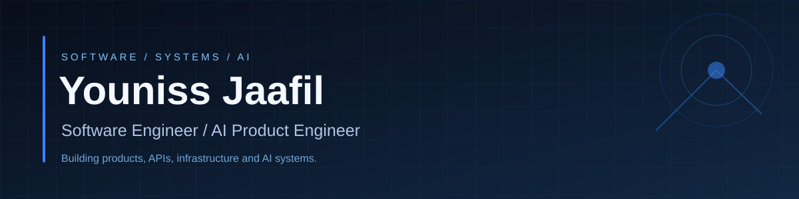

  

  <a href="https://github.com/younissjaafil?tab=repositories">Repositories</a> &nbsp;·&nbsp;
  <a href="#selected-work">Selected work</a> &nbsp;·&nbsp;
  <a href="#engineering-stack">Engineering stack</a>

### A little about me

I started out building web applications, then moved deeper into backend development, cloud infrastructure, and AI systems.

Today, I work across the stack with a particular focus on making AI features reliable in real products. That means thinking beyond prompts: tool selection, context handling, evaluation, latency, integrations, deployment, and the experience people actually use.

A lot of that work happens in private product repositories. This profile also includes earlier projects, experiments, and things I built while learning. I keep them here because they show the path, not just the current destination.

### Selected work

<table>
<tr>
<td width="50%" valign="top">

**[AthenaCore](https://github.com/younissjaafil/AthenaCore)**

AI agent platform backend built with NestJS. Includes conversation persistence, retrieval, document handling, authentication, and integrations.

Backend · AI · PostgreSQL · RAG

</td>
<td width="50%" valign="top">

**[Universal AI Agent UI](https://github.com/younissjaafil/agent-frontend)**

React interface for managing agents, chatting, working with uploaded files, and using voice features.

React · JavaScript · Product UI

</td>
</tr>
<tr>
<td width="50%" valign="top">

**[Ecommerce Backend](https://github.com/younissjaafil/Ecommerce-Backend)**

An earlier backend project from my full-stack development work.

Java · Backend

</td>
<td width="50%" valign="top">

**[DevOps Capstone](https://github.com/younissjaafil/DevOps-Capstone-Project)**

A repository from my infrastructure and DevOps learning work.

DevOps · Software delivery

</td>
</tr>
</table>

[Explore all public repositories →](https://github.com/younissjaafil?tab=repositories)

### Engineering stack

| Focus | Technologies & practices |
| --- | --- |
| **AI engineering** | Agents, MCP, tool calling, RAG, evaluations, conversation context |
| **Backend & data** | Python, Node.js, TypeScript, Java, PostgreSQL, REST APIs |
| **Frontend** | React, JavaScript, HTML, CSS |
| **Infrastructure** | AWS, Docker, Railway, CI/CD, observability |

### What I pay attention to

**Correctness over demos.** Reliable integrations and meaningful evaluations matter more than a convincing one-off output.

**Latency is a product feature.** Measuring model time, database access, and tool round-trips is part of building a usable system.

**Good software survives changes.** Clear boundaries, testing, and straightforward rollback paths make iteration easier.

---

  Based in Lebanon · <a href="https://github.com/younissjaafil?tab=repositories">View my work on GitHub</a>

